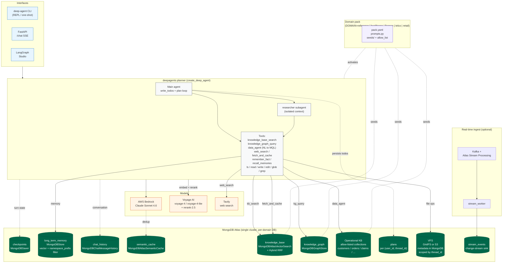

# MongoDB Langchain Deep Agents

Planning-agent reference implementation on the LangChain `deepagents` +
MongoDB Atlas joint architecture. This repo demonstrates the **planning** pattern (one main agent with a todo
list, a `researcher` subagent, and a MongoDB-backed virtual filesystem).

Industry-agnostic by construction: retarget any vertical by selecting a
**domain pack**. Five packs ship out of the box (reference, healthcare,
finance, telco, retail); deploy any of them end-to-end with a single
command. See [docs/domain-packs.md](docs/domain-packs.md).

---

## Architecture



End-to-end flow: an interface call reaches the **deepagents planner**, which
decomposes the task into a todo list, delegates research to the isolated
**researcher subagent**, and calls tools scoped by the active **domain pack**.
MongoDB Atlas owns every stateful surface - short-term checkpoints, cross-thread
memory, chat log, semantic cache, vector + hybrid KB, graph KB, operational
data, plan persistence, and the VFS - while Voyage (embed/rerank), Bedrock
(LLM), and Tavily (web) provide the model layer. Swapping `DOMAIN=` retargets
prompts, seeds, and allow-listed collections without touching `src/`.

---

## What's in the box

| Layer | MongoDB / LangChain surface | Module |
|---|---|---|
| Deep-agent orchestration | `deepagents.create_deep_agent` + `SubAgent` | `deep_agent.graph`, `deep_agent.agents.subagents` |
| Short-term state | `MongoDBSaver` (`langgraph-checkpoint-mongodb`) | `deep_agent.persistence.checkpointer` |
| Cross-thread memory | `MongoDBStore` (`langgraph-store-mongodb`) | `deep_agent.persistence.store` |
| Conversation log | `MongoDBChatMessageHistory` | `deep_agent.persistence.chat_history` |
| LLM dedup cache | `MongoDBAtlasSemanticCache` | `deep_agent.persistence.semantic_cache` |
| Vector KB | `MongoDBAtlasVectorSearch` + `MongoDBAtlasHybridSearchRetriever` (RRF) | `deep_agent.persistence.vector_store`, `deep_agent.tools.knowledge_base_search` |
| Graph KB | `MongoDBGraphStore` | `deep_agent.persistence.graph_store` |
| NL → MQL | `MongoDBDatabaseToolkit` (safety-wrapped) | `deep_agent.tools.database_toolkit` |
| **Virtual filesystem** | **MongoDB GridFS** or **S3** (pluggable via `VFS_BACKEND`) | `deep_agent.vfs.*` |
| **Plan persistence** | `plans` collection per `(user_id, thread_id)` | `deep_agent.persistence.plans` |
| Research tooling | Tavily + `fetch_and_cache` | `deep_agent.tools.web_search`, `deep_agent.tools.fetch_and_cache` |
| Real-time ingest | Atlas Stream Processing + Kafka | `streaming/` + `deep_agent.ingestion.stream_worker` |
| LLM + Embeddings | `init_chat_model` (Bedrock default) + `VoyageAIEmbeddings` + `VoyageAIRerank` | `deep_agent.models` |
| Interfaces | CLI + FastAPI (SSE) + `langgraph dev` | `deep_agent.cli`, `deep_agent.server`, `langgraph.json` |
| Evals | LangSmith dataset runner | `deep_agent.evals` |

---

## Quickstart

One command — end-to-end Docker deploy with backend, frontend, and every
domain pack seeded to its own Atlas database:

```bash
cp .env.example .env          # set MONGODB_URI, VOYAGE_API_KEY, AWS creds (TAVILY optional)
scripts/deploy.sh --all       # build images, start compose stack, seed 5 packs
# → UI: http://localhost:3000   API: http://localhost:8010
```

Single domain (leaner — one DB, no frontend rebuild of the others):

```bash
scripts/deploy.sh finance     # deploys ONLY finance into deep_agents_finance
```

Kanopy / staging:

```bash
scripts/deploy.sh --kanopy    # builds + pushes via Drone (triggers on main)
```

See [docs/DEPLOY.md](docs/DEPLOY.md) for every flag, Kanopy preflight, and
troubleshooting. `scripts/deploy.sh --help` prints the full usage inline.

### Local development (no Docker)

```bash
# 1. Install
uv sync --extra dev

# 2. Configure
cp .env.example .env          # set MONGODB_URI, VOYAGE_API_KEY, TAVILY_API_KEY, AWS creds

# 3. Unit tests (281 tests, no Atlas needed)
uv run pytest

# 4. Create indexes (idempotent)
uv run python -c "from deep_agent.persistence.indexes import ensure_indexes; ensure_indexes()"

# 5. Seed the active domain pack (default: reference)
uv run deep-agent seed
# or: DOMAIN=healthcare uv run deep-agent seed

# 6. Run
uv run deep-agent chat --user alice                         # CLI REPL
uv run deep-agent chat --once "Research X." --user alice    # one-shot
uv run deep-agent serve --port 8000                          # FastAPI (SSE /chat)
uv run langgraph dev                                         # LangGraph Studio

# 7. Integration suite (requires a running Atlas cluster)
ATLAS_URI="mongodb+srv://..." uv run pytest -m integration
```

### Virtual filesystem backends

`VFS_BACKEND=gridfs` (default) or `VFS_BACKEND=s3`. With S3:

```bash
VFS_BACKEND=s3
VFS_S3_BUCKET=deep-agent-artifacts
VFS_S3_PREFIX=deep-agent
VFS_S3_REGION=us-east-1
```

Metadata stays in MongoDB either way. See [docs/vfs-backends.md](docs/vfs-backends.md).

### Web UI (multi-domain)

A React + Vite SPA under `frontend/` serves every pack from a single backend
process. The active pack is resolved **per request** via the `X-Domain`
header, so one URL demos all five domain packs without restarting anything.

- **Domain selector** in the sidebar, backed by `GET /domains`. Switching
  clears the chat and updates the `?domain=<name>` query string so links are
  shareable.
- **Planner todos drawer** on the right — populated after every SSE `done`
  from `GET /plans?user_id=&thread_id=`. This is what makes the deep-agent
  planner pattern visible; it's the one deliberate differentiator versus the
  sibling `mongodb-langchain-agentic-ai` UI.
- **Model badge is display-only**. The label is read from `GET /health`
  (which echoes `LLM_MODEL`); there is no model selector.
- **User ID** is a free-text tag shown in the sidebar, used to scope
  long-term memory and chat history. Not an auth claim; add real auth at
  your edge before shipping.

```bash
# Multi-domain mode: MONGODB_DB is a PREFIX; the server appends _<pack>.
MONGODB_DB=deep_agent docker compose up -d
# Opens the UI at http://localhost:3000; backend at http://localhost:8010.
```

Local dev (hot-reload frontend against a running backend):

```bash
# Terminal 1: backend
DOMAIN=reference MONGODB_DB=deep_agent uv run deep-agent serve --port 8000

# Terminal 2: frontend (Vite proxies /api/* to :8000)
cd frontend && npm install && npm run dev
# → http://localhost:3000
```

See [archive/specs/400-web-ui/](archive/specs/400-web-ui/) for the full
spec, decisions log, and task breakdown.

### Streaming demo

```bash
cd streaming
docker compose up -d
mongosh "<SP-URI>" atlas_sp_pipeline.js     # optional Atlas Stream Processing
uv run python -m deep_agent.ingestion.stream_worker
```

See [docs/operators/atlas-cli-setup.md](docs/operators/atlas-cli-setup.md) for
the full Atlas bootstrap.

For full reference documentation - architecture, API, configuration,
deployment, testing, security, VFS backends, streaming, and
domain-adaptation guides - see [docs/README.md](docs/README.md).

---

## Domain packs

Five packs ship out of the box. Each is a self-contained directory under
`domains/` containing a manifest, prompts, seeds, and README:

| Pack | Use case |
|---|---|
| `reference` | Industry-neutral MongoDB/Atlas demo baseline |
| `healthcare` | Clinical-operations assistant (case managers, pharmacy) |
| `finance` | Retail-banking disputes, fraud, policy lookup |
| `telco` | NOC / tier-2 support, SLA, SIM-swap fraud |
| `retail` | E-commerce CS, returns, promo-stacking, loyalty |

Deploy any pack end-to-end with one command:

```bash
scripts/deploy.sh retail          # single pack, isolated DB
scripts/deploy.sh --all           # every pack, one backend, multi-DB
scripts/deploy.sh --kanopy        # staging via Drone
```

Or swap at runtime:

```bash
DOMAIN=finance uv run deep-agent seed
DOMAIN=finance uv run deep-agent serve
# or
uv run deep-agent --domain finance seed
```

Authoring a new pack takes five steps; see
[docs/domain-packs.md](docs/domain-packs.md). Core code is untouched; quality
gates (`tests/unit/test_quality_gates.py`) verify no industry vocabulary
leaks into `src/deep_agent/` and that every pack's manifest matches its
seed layout.

---

## Security & Governance

- **TLS enforced**: `Settings._enforce_tls` rejects any `MONGODB_URI` that
  isn't `+srv` or `tls=true`. `ALLOW_INSECURE=true` is the dev escape hatch.
- **Secrets redacted**: `Settings.__repr__` / `__str__` never emit the URI,
  Voyage, Tavily, or LangSmith keys.
- **Data agent sandbox**: `database_toolkit.enforce_safety` blocks
  destructive aggregation stages, underscore-prefixed collections, and
  non-allow-listed collections; missing `$limit` is injected at 1000.
- **Per-user memory**: every entry requires `user_id`, which scopes the
  `MongoDBStore` namespace.
- **VFS thread scoping**: every file operation carries `thread_id` as a
  top-level filter; threads cannot read each other's artifacts.
- **RBAC split**: four Atlas roles documented in
  [docs/operators/rbac-example.md](docs/operators/rbac-example.md).

---

## Testing

| Tier | Command | Requires |
|---|---|---|
| Unit | `uv run pytest` | Nothing; `mongomock` + `moto` + fakes |
| Integration | `uv run pytest -m integration` | `ATLAS_URI` |

Quality gates (`ruff check`, `mypy --strict`, domain isolation) are enforced
by tests under `tests/unit/test_quality_gates.py` so `pytest` alone fails on
regression.

---

## License

Apache-2.0.
