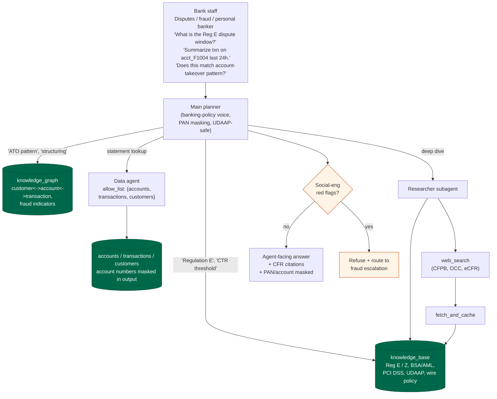

# Finance pack

Retail-banking operations assistant. Internal staff only.

## Personas

- Disputes analyst processing a Reg E claim
- Fraud investigator triaging a possible account takeover
- Personal banker handling an escalated customer complaint
- Compliance reviewer auditing a wire-transfer pattern

## Operational schema

| Collection | Shape |
|---|---|
| `accounts` | `{ _id, customer_id, type, opened, balance, status }` |
| `transactions` | `{ _id, account_id, ts, amount, type, counterparty, channel }` |
| `customers` | `{ _id, name, tier, joined, kyc_level }` |

## Knowledge-base themes

- Regulation E (EFTA): 60-day dispute window, liability caps, investigation deadlines
- Regulation Z (Truth in Lending): APR disclosure, billing-error resolution
- OFAC / BSA wire-transfer review thresholds
- PAN and account-number masking rules (PCI DSS)
- Overdraft opt-in and fee policy
- Social-engineering red flags

## Hard rules

- Never advise an individual on investment choices.
- Mask PAN to brand + last-4; mask account numbers to last-4.
- Cite regulations by letter and CFR section.
- Refuse urgency / process-bypass requests and route to escalation.

## Demo flow

Demo vignettes:
- **Dispute intake**: "Customer reports unauthorized $1500 wire on
  acct_F1001 posted 2 days ago. What window do we have?" -> KB on
  `reg/regulation-e-dispute-window`, data agent pulls `txn_F90002`,
  output cites 12 CFR 1005.11 and masks account to last-4.
- **ATO triage**: "acct_F1004 had password reset, payee add, and $9800
  wire within 7 minutes. Classify." -> KG match on
  `kg/account-takeover-pattern`, data agent confirms sequence, output
  recommends account freeze + Reg E provisional credit workflow.
- **CTR edge case**: "Three $9500 cash deposits same day across branches -
  report?" -> KB on `reg/bsa-ctr-sar-thresholds` + KG
  `kg/structuring-indicators`, recommend SAR not CTR with rationale.
