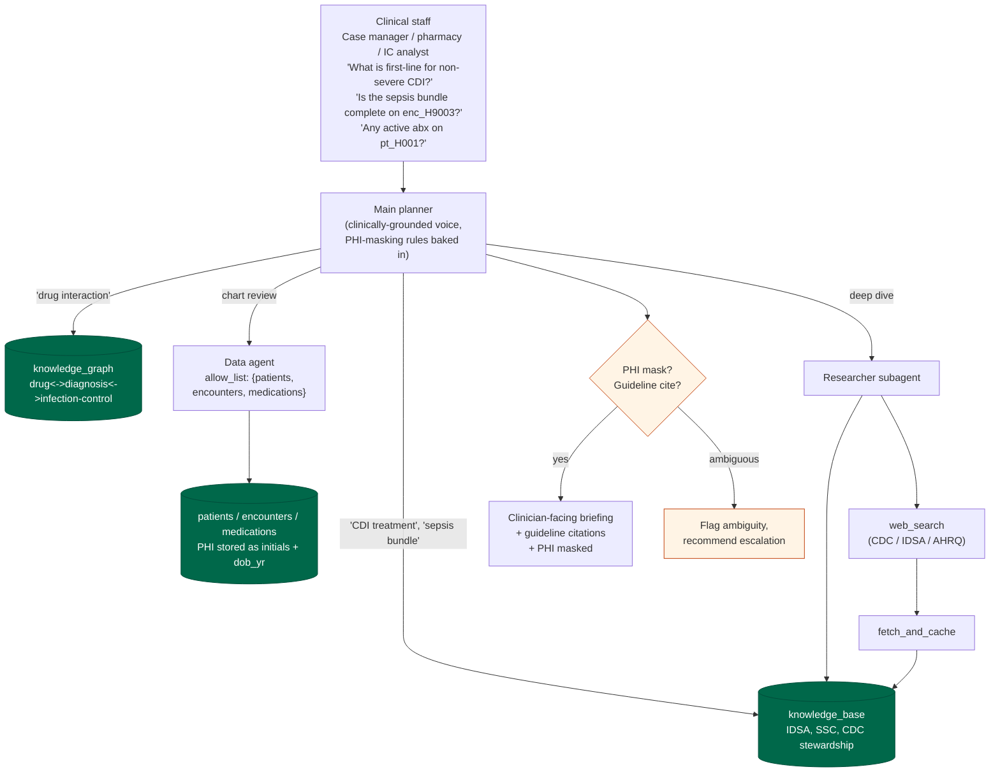

# Healthcare pack

Clinical-operations assistant for hospital staff. Not patient-facing.

## Personas

- Case manager coordinating a discharge
- Pharmacy reviewing an antibiotic order
- Infection-control analyst investigating a CDI cluster
- Quality analyst auditing sepsis bundle compliance

## Operational schema

| Collection | Shape |
|---|---|
| `patients` | `{ _id, initials, dob_yr, sex, allergies[], problem_list[] }` |
| `encounters` | `{ _id, patient_id, admit_ts, discharge_ts, unit, primary_dx }` |
| `medications` | `{ _id, patient_id, drug, dose, route, frequency, start_ts, stop_ts }` |

## Knowledge-base themes

- IDSA C. difficile treatment (vancomycin / fidaxomicin)
- Surviving Sepsis Campaign 1-hour bundle
- CDC antibiotic stewardship core elements
- PHI redaction rules (HIPAA Safe Harbor identifiers)
- Discharge-planning requirements for Medicare/Medicaid

## Hard rules

- Never advise individual patients directly.
- Always mask PHI to initials + last-4 (or similar partial) in output.
- Cite guidelines by name and version.
- If evidence is ambiguous, flag the ambiguity.

## Demo flow

Demo vignettes:
- **Stewardship review**: "pt_H001 is on vancomycin 125 mg PO QID for CDI -
  is that first-line per the current IDSA guideline?" -> KB hit on
  `guideline/idsa-cdi-2021`, chart confirmation via data agent, cited
  answer with masked initials.
- **Sepsis bundle audit**: "Did enc_H9003 receive lactate + cultures +
  abx + fluids within the 1-hour bundle?" -> multi-collection join
  (`encounters`, `medications`), KB citation on `guideline/ssc-2021-bundle`.
- **Discharge readiness**: "Is the 24-hour discharge-plan-eval window
  met on the CDI admit?" -> KB on `policy/cms-discharge-planning-482.43`.
