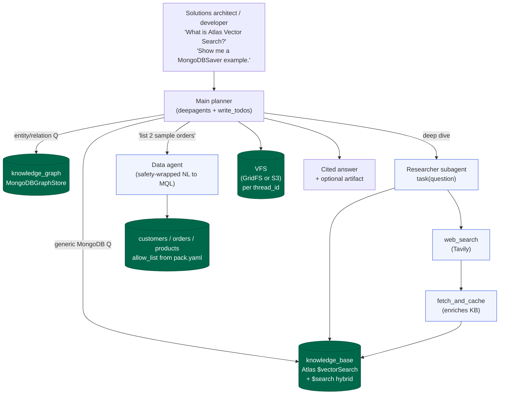

# Reference pack

Industry-neutral baseline. Use this pack for demos and integration tests
when you do not need domain-specific flavor. The knowledge base talks
about MongoDB Atlas features (Vector Search, Hybrid Search, Knowledge
Graph); the operational schema is a generic e-commerce sketch.

## Personas

- Solutions architect evaluating deep-agent + MongoDB
- Developer onboarding to the codebase
- CI running the integration tier

## Operational schema

| Collection | Shape |
|---|---|
| `customers` | `{ _id, name, email, tier, region, joined_at }` |
| `orders` | `{ _id, customer_id, total, status, items: [...] }` |
| `products` | `{ _id, name, price, category, in_stock }` |

## Knowledge-base themes

- MongoDB Atlas Vector Search overview
- Hybrid search (BM25 + vector)
- Knowledge-graph entity/relation modelling
- Deep-agent architecture concepts

## Demo flow

Probing questions the reference demo answers:
- "How does Atlas Vector Search differ from Atlas Search?"
- "Show me two recent orders and which customer placed them."
- "Which LangChain MongoDB package owns the checkpoint collections?"

## Swap recipe

See [docs/domain-packs.md](../../docs/domain-packs.md) for the full
authoring guide.
