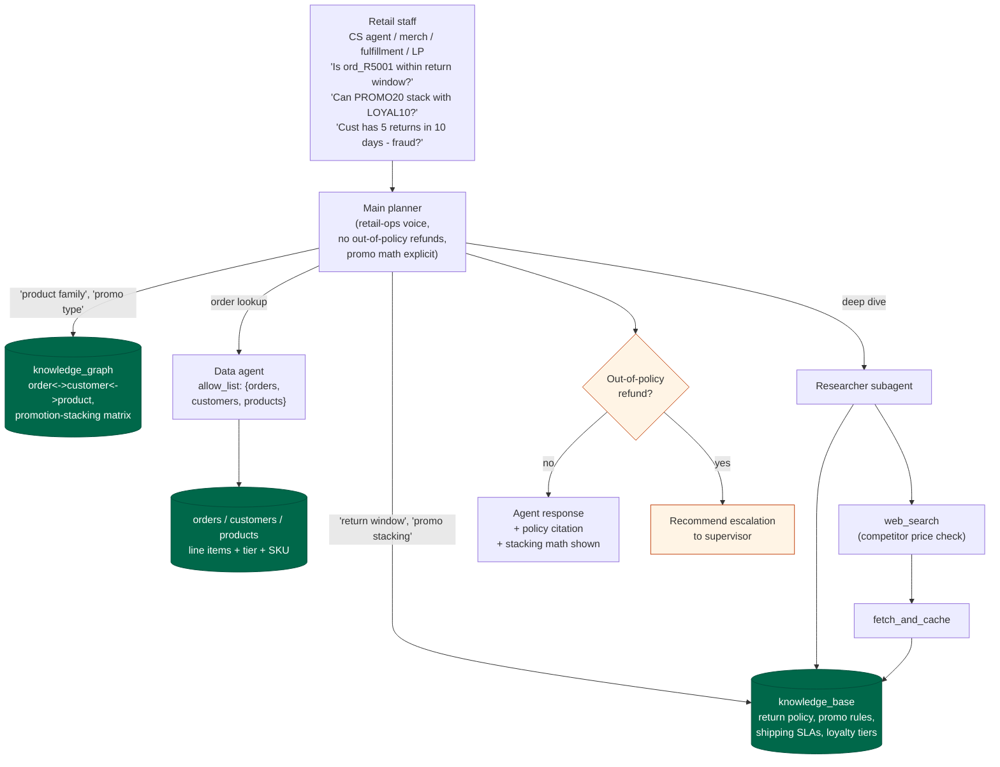

# Retail pack

Retail / e-commerce operations assistant. Internal staff only.

## Personas

- Customer-service agent handling a return request
- Merchandising coordinator planning a promotion
- Fulfillment supervisor triaging a late shipment
- Loss-prevention analyst investigating a return-fraud pattern

## Operational schema

| Collection | Shape |
|---|---|
| `orders` | `{ _id, customer_id, total, status, created_at, items: [{sku, qty, unit_price}] }` |
| `customers` | `{ _id, name, email, tier, region, joined_at }` |
| `products` | `{ _id (sku), name, price, currency, category, in_stock }` |

## Knowledge-base themes

- 30-day return window, exclusions (intimate apparel, final-sale)
- Promotion-stacking rules (one percentage + one fixed-dollar + loyalty)
- Shipping SLAs by region and service level
- Price-match competitor list and window
- Loyalty tiers (silver / gold / platinum) and benefits
- Return-fraud indicators

## Hard rules

- Never commit to an out-of-policy refund; escalate.
- Quote return windows and prices only as they appear in the cited source.
- Show promotion-stacking math step-by-step with rule citations.
- Mask PAN to brand + last-4 if it appears in order notes.

## Demo flow

Demo vignettes:
- **Return eligibility**: "ord_R5001 delivered 2026-04-03, customer wants
  to return the All-Weather Jacket today." -> KB on
  `policy/returns-standard-window` (30 days), data agent shows order
  and delivery date, answer computes days elapsed + eligible status.
- **Promo stacking**: "PROMO20 (20% off) + LOYAL10 (10% off Gold) + $25
  off first-order - can they stack for cust_R001?" -> KG on
  `kg/promotion-stacking`, KB on `policy/promo-stacking`, answer shows
  the stacking matrix decision (two percentage-off not allowed) and
  computed total.
- **Return-fraud flag**: "cust_R001 placed ord_R5004 for 5x jacket at
  $349.99 each, now wants full refund." -> KB on
  `policy/return-fraud-indicators`, data agent confirms
  `status=cancelled-fraud-review`, recommend loss-prevention review.
