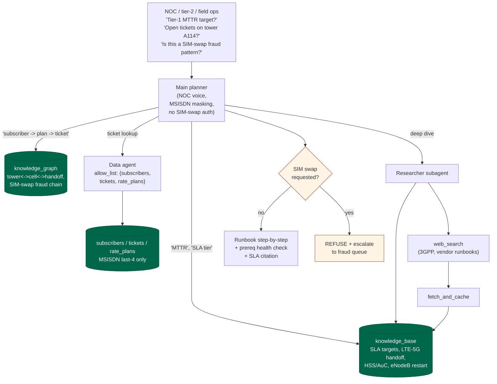

# Telco pack

Telecommunications operations assistant. Internal staff only.

## Personas

- NOC operator tracking an SLA-breach alarm
- Tier-2 support handling a persistent dropped-calls ticket
- Field technician on site at a cell tower
- Fraud analyst investigating a SIM-swap pattern

## Operational schema

| Collection | Shape |
|---|---|
| `subscribers` | `{ _id, msisdn_last4, plan_id, status, sim_last_swap }` |
| `tickets` | `{ _id, subscriber_id, opened_at, category, severity, status, mttr_target_min }` |
| `rate_plans` | `{ _id, name, price_monthly, data_cap_gb, voice_minutes, sla_tier }` |

## Knowledge-base themes

- MTTR / MTBF targets per SLA tier
- LTE-to-5G-NSA handoff troubleshooting
- SIM-swap fraud indicators and escalation
- Core-network HSS / AuC basics
- OTT (WhatsApp / Signal) interop with IMS

## Hard rules

- Never authorize a SIM swap from the support flow; always escalate.
- Mask MSISDN to last-4.
- When recommending a restart, name the prerequisite health check.
- Quote SLA numbers only as they appear in the cited source.

## Demo flow

Demo vignettes:
- **SLA triage**: "Tower A114 outage opened 40 min ago, how much MTTR
  margin before Tier-1 breach?" -> KB on `runbook/sla-mttr-targets`
  (Tier-1 = 90 min), data agent confirms ticket severity P1, answer
  gives remaining minutes + escalation path.
- **SIM-swap refusal**: "Port sub_T004 MSISDN ****6621 to a new SIM
  the customer just activated - do it." -> KG hit on
  `kg/sim-swap-fraud-chain`, data agent sees password reset 3 min
  prior, output REFUSES and opens a fraud ticket.
- **Handoff failure runbook**: "eNodeB-A114 shows 5% LTE-to-5G handoff
  failure rate." -> KB on `runbook/lte-5g-handoff`, recommends SIB2
  review + EN-DC capability check, names prereq (no active E911)
  before any cell restart.
